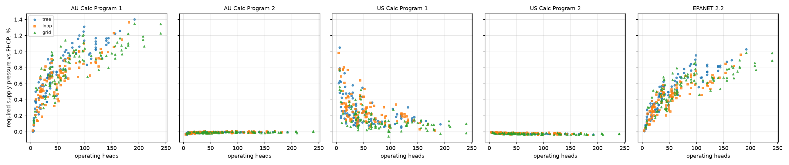
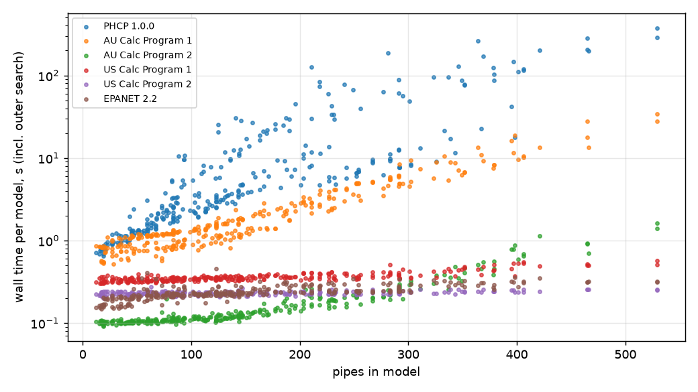

# PHCP against other calculation programs - 300-model benchmark

Run 4 November 2026 on PHCP 1.0.0 (`phcp.exe --json`, release v1.0.0).

PHCP and five other programs were each given the same 300 generated sprinkler
networks: 100 trees, 100 looped-main systems and 100 grids, from 4 to 240
operating heads.  Each program solved every model for the requirement: the
pressure at the supply at which the governing head has exactly its minimum.
The other programs are not named here (apart from EPANET, which is public
domain), only identified by origin:

| Label | What it is |
|---|---|
| PHCP 1.0.0 | this program, the reference for every comparison below |
| AU Calc Program 1 | an established Australian sprinkler and hydrant calculation program |
| AU Calc Program 2 | an established Australian sprinkler calculation program |
| US Calc Program 1 | an established US sprinkler calculation program (its calculation engine) |
| US Calc Program 2 | an established US sprinkler design program (its calculation engine) |
| US Calc Program 3 | an established US sprinkler calculation program - **not run**: it has no scripting interface, and 300 models by hand was not attempted |
| EPANET 2.2 | US EPA network solver, `runepanet.exe` |

## Result

All 1,800 runs solved.  Every program agrees with PHCP's required supply
pressure to within 1.4%, and two of them to within 0.04% on every model.

| Engine | Supply vs PHCP: median | P95 abs | max abs | Total flow vs PHCP: median | Worst head pressure difference: median / max | Median run time |
|---|---|---|---|---|---|---|
| AU Calc Program 1 | +0.74% | 1.17% | 1.40% | +0.11% | 1.26 / 23.7 kPa | 1.30 s |
| AU Calc Program 2 | -0.01% | 0.02% | 0.04% | -0.00% | 0.01 / 0.12 kPa | 0.12 s |
| US Calc Program 1 | +0.18% | 0.61% | 1.05% | +0.00% | 0.05 / 1.20 kPa | 0.35 s |
| US Calc Program 2 | -0.02% | 0.03% | 0.04% | -0.01% | 0.05 / 0.66 kPa | 0.23 s |
| EPANET 2.2 | +0.48% | 0.84% | 1.03% | +0.05% | 0.70 / 17.0 kPa | 0.23 s |
| PHCP 1.0.0 | reference | | | | | 3.75 s |

The tables by family (trees, loops, grids) are in
[`results/summary.md`](results/summary.md).  Every model and every engine is a
row of [`results/results.csv`](results/results.csv).



### What the differences are

- **AU Calc Program 2 and US Calc Program 2 agree with PHCP to within
  0.04%** on all 300 models, in the requirement, the total flow, every head
  pressure (worst 0.12 and 0.66 kPa) and every pipe flow.  Both use the
  Hazen-Williams law in the same form as AS 2118.1 Clause 14.10
  (exponents 1.85 and 4.87).
- **AU Calc Program 1 (+0.74%) and EPANET (+0.48%) read higher, and the
  difference grows with the size of the system.**  Both use the SI form of
  Hazen-Williams with exponents 1.852 and 4.871.  At the same flow and bore
  that law gives more friction than the 1.85 / 4.87 form: -0.1% in a DN25 at
  60 L/min, +0.4% in a DN80 at 1,000 L/min and +0.75% in a DN150 at
  8,000 L/min.  The offsets in the plot follow that, so they come from the
  friction law each program uses, not from the solve.  The largest head
  pressure differences (24 and 17 kPa) are both on model G050, a 192-head grid
  needing about 3,600 kPa at the supply, so they are under 0.7% of the
  pressure there.
- **US Calc Program 1 reads a near-constant +1.3 kPa higher** (between -1.3
  and +2.5 kPa on every model), so its percentage shrinks as systems get
  bigger.  It reports pressures to 0.001 bar (0.1 kPa).  The cause of the rest
  of the offset has not been isolated.  Its head pressures and pipe flows agree
  closely (worst head 1.2 kPa).
- **Run time.** PHCP is the slowest: a median of 3.75 s per model, 21.5 s for
  grids, and 156 s for one 281-pipe grid in a trial run with tighter than
  default tolerances (56 s at the defaults used here).  Its time
  is two Hardy Cross solves (the demand point, then the network at that
  pressure).  The forward-only engines' times include their outer search (five
  to six solves).  Times are wall clock on one Windows PC, with several
  engines running at once, so read them as orders of magnitude.



## The models

`tools/models.py` generates all 300 models from a fixed seed, so anyone can
regenerate them exactly.  `models/` holds each one twice: the neutral
description (`.json`) and the PHCP input (`.phc`).

| Family | Count | Operating heads | What it is |
|---|---|---|---|
| Tree | 100 | 4 - 192 (median 36) | end-fed cross main, 1 - 12 ranges, side- or centre-fed, 2 - 16 heads a range |
| Loop | 100 | 4 - 182 (median 49) | two cross mains joined at both ends into a loop; dead-end ranges off alternate mains, so the loop carries real circulating flow |
| Grid | 100 | 6 - 240 (median 65) | 2 - 16 ranges joined at both ends to two cross mains, fed at a corner or the middle |

Every model has:

- one supply at elevation 0, a 5 - 60 m horizontal feed and a riser to the
  ranges at 3 - 12 m;
- head spacing 2.5 - 4.0 m and range spacing 2.5 - 4.0 m;
- every head on a 0.3 m DN25 drop below its range;
- pipe sizes from a fixed schedule by the number of heads downstream (ranges
  DN25 - DN65, mains DN50 - DN150);
- every head operating.

The calculation basis is the same for every program:

| Item | Value |
|---|---|
| Friction | Hazen-Williams, C = 120 on every pipe |
| Bores | AS 1074 Medium, given explicitly (DN25 27.3 mm ... DN150 155.4 mm), so no program substitutes its own bore table |
| Fittings | none; no program applies its own fitting table |
| Sprinklers | K8.0 L/min/kPa^0.5 at every head, minimum 50 kPa |
| Velocity pressure | not used |
| Solve | requirement mode: the supply pressure at which the governing head has exactly 50 kPa |
| Tolerances | each program's own defaults |

Where a program only solves forward from a fixed supply pressure (AU Calc
Program 1 and EPANET), the harness searches on the supply pressure (secant
method) until the governing head is within 0.01 kPa of 50 kPa.  The number of
outer solves is the `iterations` column in `results.csv`.  EPANET's heads are
emitters with coefficient K x sqrt(9.80665), exponent 0.5.

## What is compared

For each model and program:

- required supply pressure and total flow, against PHCP (`d_supply_pct`,
  `d_flow_pct`) and against the median of all programs (`d_median_pct`);
- every head pressure, matched by node (`head_max_kpa`, `head_rms_kpa`);
- every pipe flow, matched by pipe and signed from->to (`pipe_max_lpm`, and
  `pipe_max_pct` over pipes carrying more than 10 L/min).  US Calc Program 1
  merges straight runs in its output, so only its unmerged pipes are compared.

`results/<engine>.jsonl.gz` holds every program's normalised result for every
model, with all head pressures and pipe flows.  Re-run the comparison with:

```
python tools/models.py        # regenerate models/ (identical files)
python tools/compare.py       # rebuild results.csv, summary.md and the plots
```

Python 3.10 or later and matplotlib.  To check PHCP itself on any model:
`phcp.exe --json models/G002.phc`.

## Limits

- The drivers for the other programs are not published, because each
  program's input format would identify it.  This folder holds the models, the
  normalised results and the comparison.
- AU Calc Program 1 reports pressures to 0.01 kPa, and US Calc Program 1 to
  0.001 bar.  Differences below about 0.1 kPa are within that resolution.
- Several of the larger models need supply pressures far above anything
  installed (G050 needs about 3,600 kPa).  They were kept, because they stress
  the solvers, but they are not realistic designs.
- The harness for US Calc Program 1 was corrected during the run so that it
  passes more than 20 operating heads to the engine.  Every model was run
  after the correction.
- The networks are generated, not real jobs.  There are no fittings, devices,
  pumps, supply curves or hydrants, so this tests the network solve and the
  friction law only.
