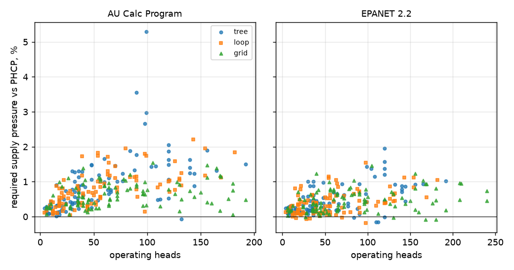

# Round 2 - fittings and devices

Run 4 November 2026 on PHCP 1.0.0, on the same 300 networks as round 1
([README.md](README.md)).  Two suites:

| Suite | What is added to every round-1 network | Programs |
|---|---|---|
| A | fittings: one equivalent length per pipe from AS 2118.1:2017 Table 14.11.1, the same length to every program | all six |
| B | the suite A fittings, plus a BFP loss curve in the feed, a fixed-drop PRV in the riser and a fixed-bore orifice plate in the first DN50 - DN100 main | PHCP, AU Calc Program and EPANET 2.2 - the programs that take all three devices natively |

US Calc Programs 1 to 3 were not given the devices: none of them takes all three
through a scripting interface.  Approximating a device a program does not have
would test the conversion, not the program.

## Result

**Suite A (fittings)** - all 1,800 runs solved.  Every program reads the
equivalent lengths the same way, and the differences are those of round 1:

| Program | Supply vs PHCP: median | worst |
|---|---|---|
| AU Calc Program | +0.77% | 1.41% |
| US Calc Program 1 | +0.15% | 0.96% |
| US Calc Program 2 | -0.02% | 0.04% |
| US Calc Program 3 | -0.01% | 0.04% |
| EPANET 2.2 | +0.50% | 1.03% |

**Suite B (devices)** - 895 of 900 runs solved.

| Program | Solved | Supply vs PHCP: median | P95 | worst | Median run time |
|---|---|---|---|---|---|
| PHCP 1.0.0 | 300 / 300 | reference | | | 7.5 s |
| AU Calc Program | 295 / 300 | +0.67% | 1.77% | 5.29% | 2.3 s |
| EPANET 2.2 | 300 / 300 | +0.35% | 1.05% | 1.95% | 0.3 s |



- **The devices agree.**  On a single test pipe, PHCP and AU Calc Program gave
  the same BFP loss and the same fixed PRV drop: the flows differed by 0.13%
  and 0.11%, the friction-law offset of round 1.  Over the 300 networks the
  medians move by less than 0.2% from suite A.
- **The orifice plate.**  PHCP's default model (Cd 0.596 with the ISO 5167
  pressure-recovery ratio, giving the net loss across the plate) and the
  AS 2118.1 Appendix C method used by the other two (a Cd from 0.61 at
  d/D 0.5 to 0.95 at d/D 0.8, no recovery term) give practically the same
  loss: on the first models checked, PHCP and EPANET's requirements agreed to
  0.03%.  Passing an Appendix C Cd to PHCP's `OFD` exposed a defect: the
  CD given only entered the recovery ratio.  It is fixed in PHCP#29; suite B
  ran PHCP at its default Cd.
- **AU Calc Program refuses a fixed-bore plate in a DN150 pipe** (its stated
  range is 50 - 200 mm): the five grids whose mains are all DN150 are its five
  unsolved runs.
- **The widest differences (AU Calc Program up to 5.3%) are four trees that
  need 4,200 - 6,600 kPa**, with about 10,000 L/min through a DN100 feed and
  its BFP at the top of its curve.  PHCP reads a BFP curve as a supply curve
  (straight lines on Q^1.85 paper); the other two interpolate linearly in Q.
  Near the top of a steep curve that, and the friction law at 20 m/s,
  compound.  No model a designer would build is in that range.
- **Run time.** PHCP's Hardy Cross iteration is the slowest here too, by
  choice: every loop correction is traceable in the report.  With devices it
  slows further on large grids: median 35 s for grids, and three grids of 150
  to 169 heads took 32 to 51 minutes (the other two programs: seconds).

## Basis of the devices

`tools/devices.py` builds both suites from the round-1 models; the networks
are unchanged, and the device values have their own random stream
(seed + 7).

| Device | Where | How it is given |
|---|---|---|
| Fittings | by pipe role | feed: gate valve + alarm valve + 2 elbows; riser: elbow; loop crossover: 2 elbows; range take-off, grid range end and drop: tee, flow turned. Table 14.11.1, C = 120 |
| BFP | the feed | loss = a + b (Q/Qr)^2 kPa, a 30 - 50, b 30 - 60, Qr about the design flow; 8 points from 0 to 2 Qr |
| PRV | the riser | a fixed drop, 50 - 150 kPa |
| Orifice plate | the first DN50 - DN100 main after the riser | a fixed bore, d/D 0.55 - 0.75 |

How each program was given them: PHCP `EQV`, `BFP`, `PRV <pipe> 0 <drop>`,
`OFD <pipe> <bore>`; EPANET the length, a general-purpose valve on the BFP
curve, a pressure-breaker valve for the PRV, and a minor-loss K =
(1 - b^4) / (Cd^2 b^4) for the plate; AU Calc Program its own records for each.

## Files

`models_A/` and `models_B/` hold every model as `.json` and `.phc`;
`results_A/` and `results_B/` hold the normalised results, `results.csv`,
`summary.md` and the plots.  Regenerate and re-compare with:

```
python tools/devices.py       # models_A/ and models_B/ (identical files)
python tools/compare.py A
python tools/compare.py B
```

The outer search on the supply pressure (for the programs that solve forward
only) gained a bracketed fallback in round 2; three suite B runs needed it.
One AU Calc Program run (T061) stops 0.14 kPa from the 50 kPa target, which
is its output resolution; it is kept.
