# PHCP User Guide

This guide is for a designer using PHCP to calculate a sprinkler, hydrant or
hose reel system.  It walks through the three windows, a first calculation,
and how to read the result.  Every command of the model language is in the
PHCP Reference Manual.  How the program works, how it is tested and what it
does not do are in the README on GitHub.

The pictures are taken from the programs themselves by
`tools/doc_screenshots.pl`, which CI runs on every pull request.  Each one
shows `examples/02_full_network.phc` after VALIDATE and CALCULATE.  That
example has two supplies (a tank with a booster pump, and a town main),
pressure devices, sprinklers, a hydrant and a hose reel.

Contents

1. [Getting PHCP](#1-getting-phcp)
2. [The model file](#2-the-model-file)
3. [The text editor](#3-the-text-editor)
4. [Validate, then calculate](#4-validate-then-calculate)
5. [The results tables](#5-the-results-tables)
6. [Reading the result: accepted or not](#6-reading-the-result-accepted-or-not)
7. [The report](#7-the-report)
8. [The PROJECT tab](#8-the-project-tab)
9. [The spreadsheet window](#9-the-spreadsheet-window)
10. [The isometric drawing](#10-the-isometric-drawing)
11. [Water supply graph](#11-water-supply-graph)
12. [Quick tools and the orifice plate](#12-quick-tools-and-the-orifice-plate)
13. [The pipe and fitting database](#13-the-pipe-and-fitting-database)
14. [Supplies, pumps and check valves](#14-supplies-pumps-and-check-valves)
15. [Without a window: the command line and JSON](#15-without-a-window-the-command-line-and-json)
16. [When something goes wrong](#16-when-something-goes-wrong)

## 1. Getting PHCP

**On Windows**, download the programs from the latest release on GitHub
(Releases, under Assets):

| Program | What it is |
|---|---|
| `phcp_editor.exe` | the text editor: the model as command lines.  Start here |
| `phcp_sheet.exe` | the spreadsheet: the same model as grids of pipes, nodes, supplies and devices |
| `phcp_isometric.exe` | the isometric drawing: the same model drawn on a 30-degree grid |
| `phcp.exe` | the command-line program: a model in, a report or JSON out |

Each is a single file with the pipe and fitting database inside.  Nothing
needs installing.  All four read and write the same `.phc` file, so a model
can be started in one window and finished in another.

**From source** (any system with Perl 5.38 or later, and Perl/Tk for the
windows):

```
perl phcp_editor.pl model.phc
perl phcp_sheet.pl model.phc
perl phcp_isometric.pl model.phc
perl phcp.pl model.phc report.pdf
```

The `examples/` folder holds worked models.  `02_full_network.phc` is the one
in the pictures, and `01_single_branch.phc` is the simplest.

## 2. The model file

A model is a plain-text `.phc` file, one command a line, in capitals:

```
WATER     T1 0.0 200              // a supply: node, elevation, pressure
NODE      J1 0.0
SPRINKLER X2 10.0 -50 80          // node, elevation, K-factor (negative: a catalogue K), minimum pressure
USE       BORE 120
PIPE      M1 J2 A 30 150 2E T     // name, from, to, length, size, fittings
```

The file's head holds the title, project details, units and calculation
options.  In the windows those are set in the PROJECT tab (section 8), not
typed.  `//` starts a comment.  The reference manual has every command, its
fields and its units.

## 3. The text editor

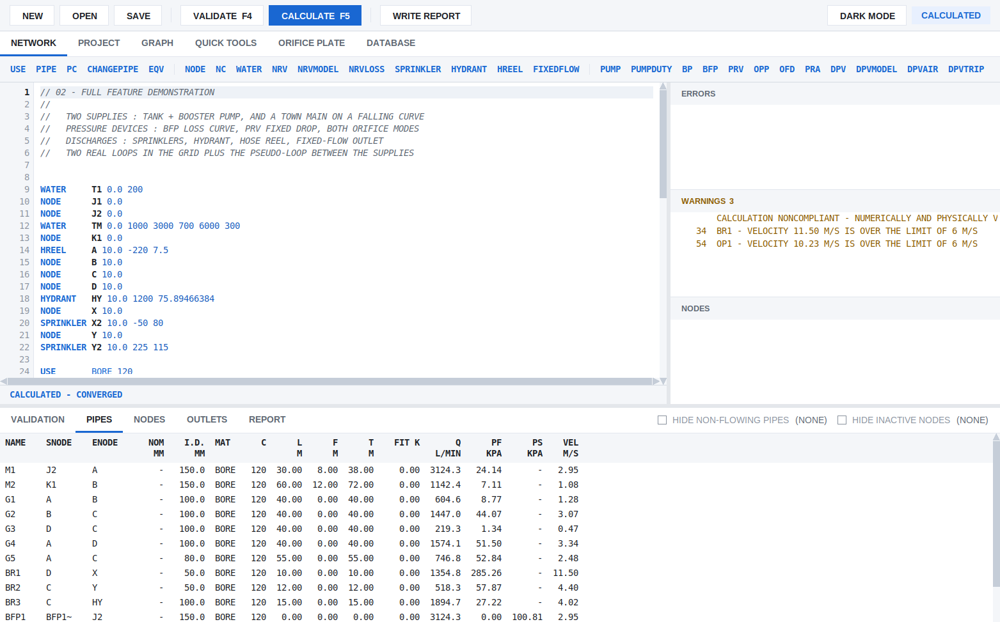

From the top:

- **Toolbar.**  NEW, OPEN and SAVE; VALIDATE (F4) and CALCULATE (F5); WRITE
  REPORT (Ctrl+R).  On the right, DARK MODE, and the state of the model: NOT
  VALIDATED, VALIDATED or CALCULATED.
- **Tabs.**  NETWORK (the model), PROJECT, GRAPH, QUICK TOOLS, ORIFICE PLATE
  and DATABASE.
- **Command strip.**  Every network command, in four groups: pipes; nodes and
  outlets; pumps and devices; design areas and supply graphs.  A click starts
  a line with that command.
- **The editor.**  Command words are blue, a name being defined is bold, and
  comments are grey.  A line in error has a pale red band and a red line
  number.  After Enter, the likely next line is offered in grey (the next
  pipe name, starting where the last pipe ended).  Enter or Tab accepts it,
  and anything else discards it.  Ctrl+Space in a pipe type or a fitting
  string lists the codes.
- **Status bar** (under the editor).  The field template of the command the
  cursor is on, with the current field highlighted.  After a calculation it
  shows that line's results.  While a calculation runs it says COMPUTING,
  with what is being done and the seconds gone.
- **ERRORS, WARNINGS, NODES** (right).  Live as you type: lines the reader
  refuses, the last calculation's warnings, and nodes that are undefined or
  unconnected.  A click goes to the line.
- **Results** (bottom).  VALIDATION, PIPES, NODES, OUTLETS and REPORT
  (section 5).

The grey bands between the panes can be dragged, and the mouse wheel scrolls
whichever pane is under the pointer.  Ctrl+Z and Ctrl+Y undo and redo.

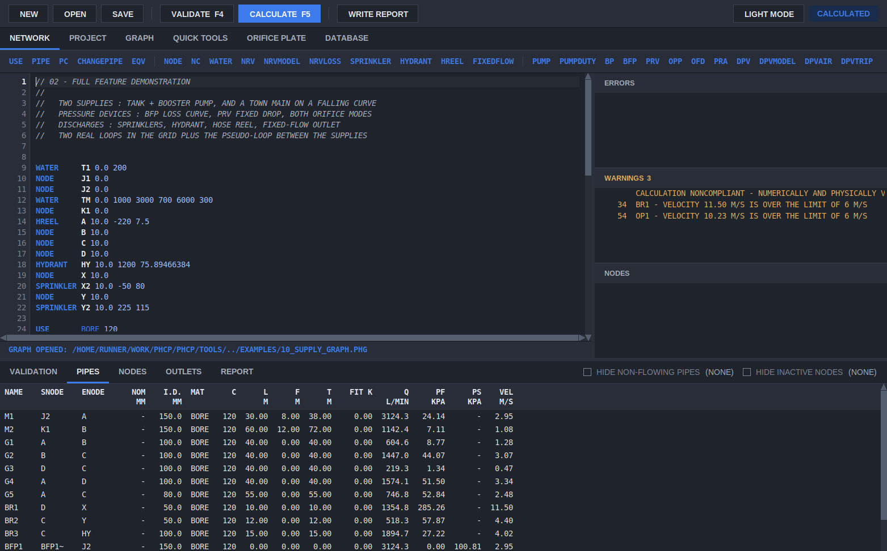

VIEW > DARK MODE, or the DARK MODE button, switches the window to the dark
palette.  Each window remembers its own choice.

## 4. Validate, then calculate

CALCULATE is available only when the model is exactly as it was when it last
passed VALIDATE.  Any edit, in the editor or the PROJECT tab, turns it off
again.

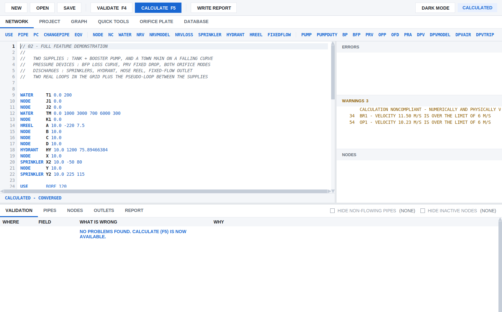

VALIDATE (F4) checks every line, the settings, and the network's structure
as the solver will see it.  Each problem is a row:

| Column | Holds |
|---|---|
| WHERE | the line, or PROJECT TAB |
| FIELD | the field at fault |
| WHAT IS WRONG | the problem |
| WHY | what the program needs, in plain words; for a short line, how the command is written |

A click on a row goes to the field and selects it.  When there are no
problems, the tab says so and CALCULATE (F5) is available.

CALCULATE solves the network by the Hardy Cross method, then checks the
solution again from scratch (section 6).  A large grid, a design area search
or auto sizing can take a while.  The status bar shows what is being done
and the window stays responsive.

## 5. The results tables

**PIPES** (in the first picture) has one row a pipe: its ends, nominal and
internal diameter, material, C factor, length, fitting and total equivalent
length, flow Q, friction loss PF, loss across a device PS, and velocity.
A right click on the headings chooses from 21 columns, including Reynolds
number, Darcy friction factor and the formula used.  A click on a heading
sorts by it.

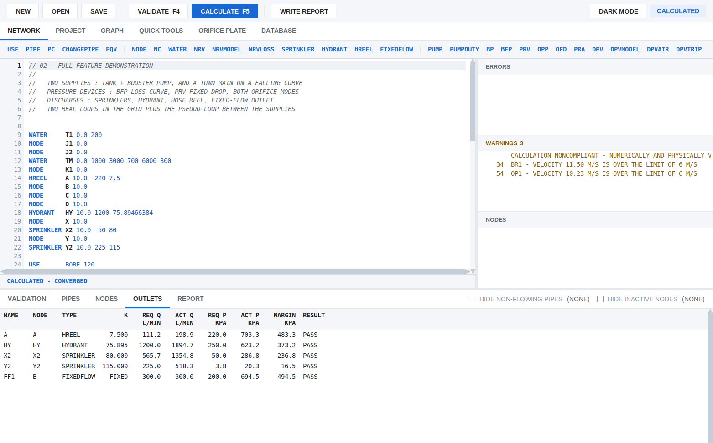

**OUTLETS** lists every sprinkler, hydrant, hose reel and fixed flow: the
required and achieved flow and pressure, the margin, and PASS or FAIL.
**NODES** lists every node's elevation, pressure and discharge.  HIDE
NON-FLOWING PIPES and HIDE INACTIVE NODES shorten long tables.  The count
beside each is how many rows it would hide.

## 6. Reading the result: accepted or not

A calculation that converges is not automatically an accepted design.  PHCP
checks every solve again from the final flows and pressures, and gives one of
four results.  The same result appears on the cover sheet, in the report,
in the JSON and in the editor's WARNINGS:

| Result | Meaning | What to do |
|---|---|---|
| **ACCEPTED** | numerically and physically valid, and every design requirement met | nothing; this is PHCP's own check, not an independent certification |
| **NONCOMPLIANT** | a valid calculation, but the design fails: an outlet short of its flow or pressure, a velocity over the limit set, the supply short of the demand, a pump duty missed, or part of the system cut off from its supply | change the design |
| **REJECTED** | converged, but not a physically valid answer, for example a supply or backflow preventer passing water backwards | correct the model |
| **INDETERMINATE** | no settled, converged solution | see section 16 |

The example in the pictures is NONCOMPLIANT: the WARNINGS list says so on its
first line, and two branch pipes exceed 6 m/s.  Section 14 of the report
lists every failed requirement on its own.

## 7. The report

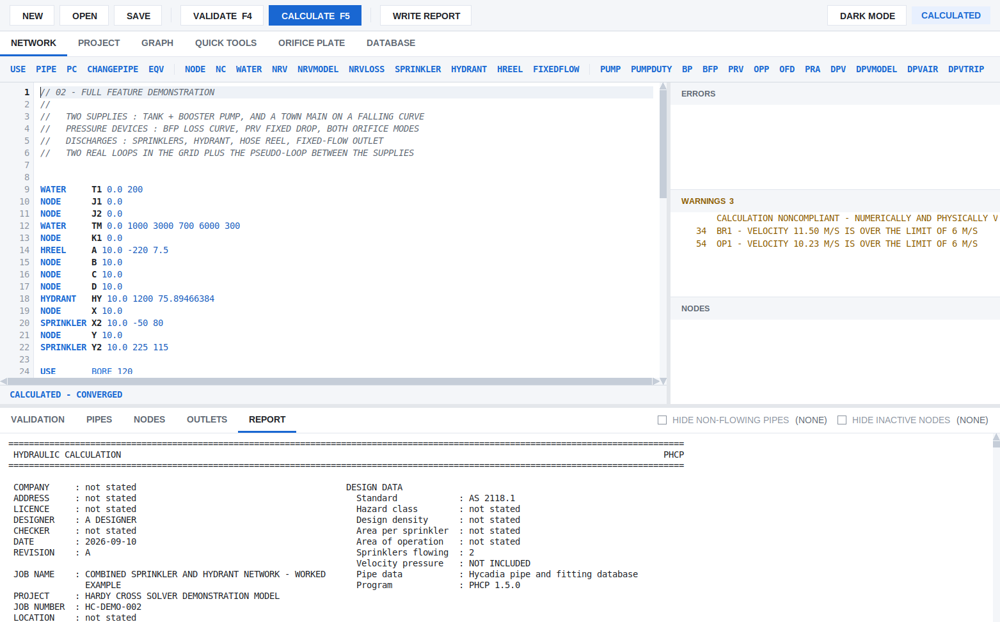

The REPORT tab shows the calculation report as it will be printed.  WRITE
REPORT (Ctrl+R) saves it as PDF (`.pdf`) or plain text (`.txt`), and
validates and calculates first if needed.  The report is monospace 7-bit
ASCII, so it reads the same in any viewer.  It has:

- the **cover sheet**: the project details and design basis from the PROJECT
  tab, the program version, and the result (section 6);
- the **pipe schedule**, the **node and outlet tables**, the **flow path**
  from the supply to the governing outlet, and the **supply** against the
  demand, with the margin;
- the supplies, pumps and check valves (Section 10), any dry pipe valve
  times, design areas and scenarios that the model has;
- **validation** (Section 14): every numerical, physical and design check,
  with its worst value and tolerance;
- any water supply graph named by `SUPPLYGRAPH`, as an appendix.

## 8. The PROJECT tab

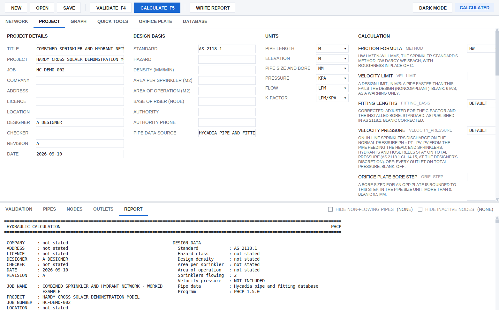

The editor holds the network only.  The PROJECT tab holds what goes at the
head of the `.phc` file:

- **PROJECT DETAILS** and **DESIGN BASIS**: what goes on the report's cover
  sheet;
- **UNITS**: each a drop-down, with the default marked;
- **CALCULATION**: the friction formula (Hazen-Williams or Darcy-Weisbach),
  the velocity limit, the fitting basis, velocity pressure, the orifice bore
  step and the rest.  Each has a plain label, its `.phc` name beside it, and
  a line saying what it does and what a blank means.  The rarely needed
  solver settings are under SOLVER - ADVANCED.

A setting typed into the network instead is marked as an error that says
where it belongs.

## 9. The spreadsheet window

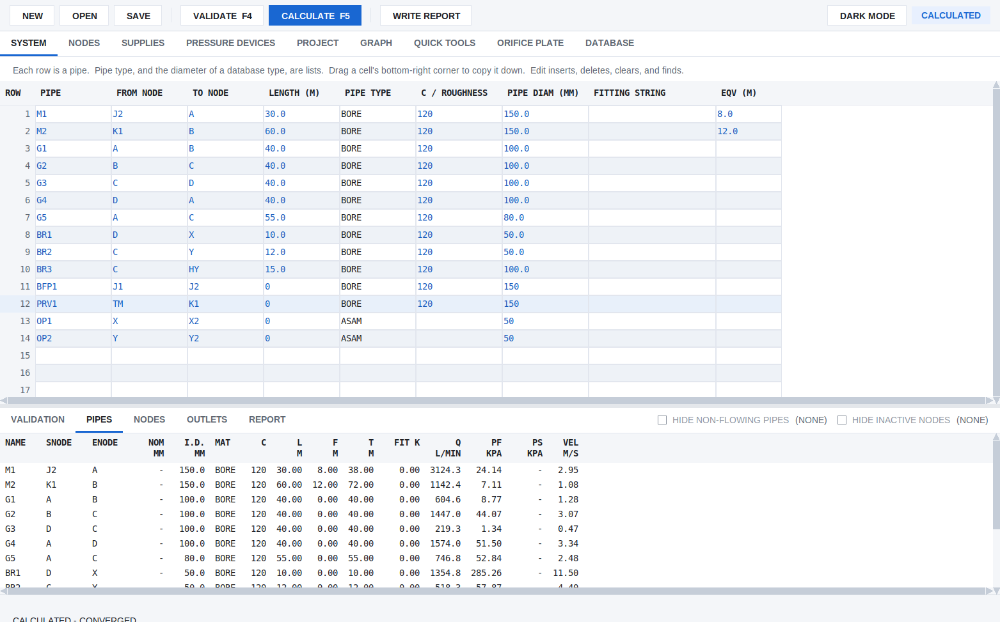

`phcp_sheet` is the same engine and the same file with the network as grids
instead of command lines.  The PROJECT, GRAPH, QUICK TOOLS, ORIFICE PLATE,
DATABASE and results tabs are the editor's.

| Tab | Holds |
|---|---|
| SYSTEM | one row a pipe: from node, to node, length, pipe type, C or roughness, diameter, fittings, extra equivalent length |
| NODES | every node named in SYSTEM: type, elevation, fixed flow, minimum flow and pressure, K |
| SUPPLIES | each supply's static pressure and its flow/pressure points |
| PRESSURE DEVICES | a table for each of PUMP, BP, BFP, PRV, OPP, OFD and PRA |

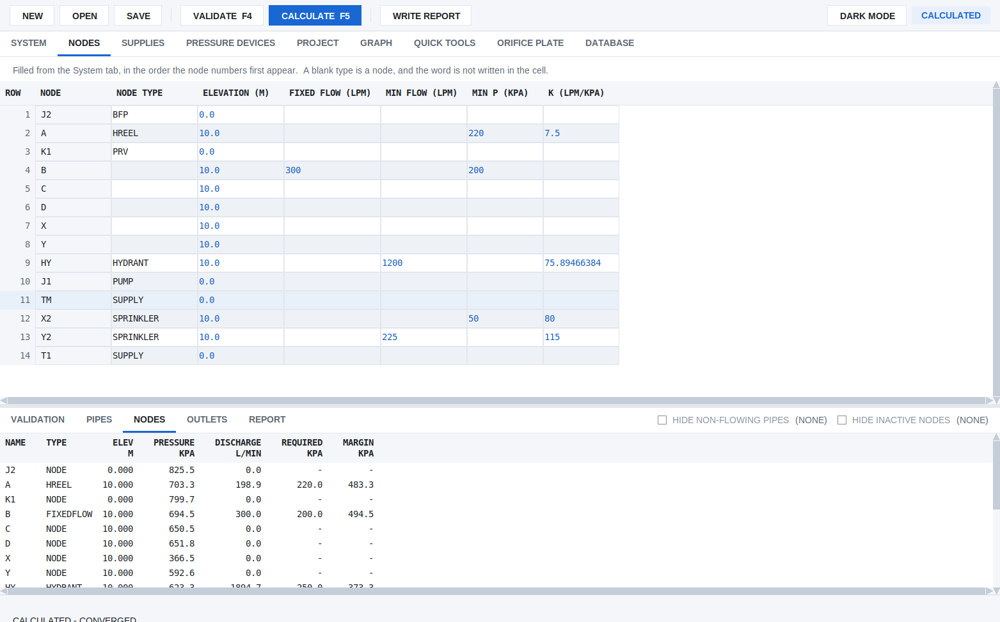

Typing in the grids:

- PIPE TYPE, PIPE DIAM and NODE TYPE are lists.  Typing completes a match;
  Tab keeps it and moves on; Down walks the other matches.
- A blank pipe type takes the row above's, as a `USE` line does.  A run of
  the same type and size carries on by itself.
- Enter on the last SYSTEM row adds a row.  Drag a cell's bottom-right
  corner to copy it down, or Ctrl+D to copy it into the next row.
- EDIT inserts, deletes and clears rows, and FIND and REPLACE work on one
  grid or all of them.
- Nodes, supplies and devices are filled from the SYSTEM grid: insert or
  delete a pipe there and the others follow.

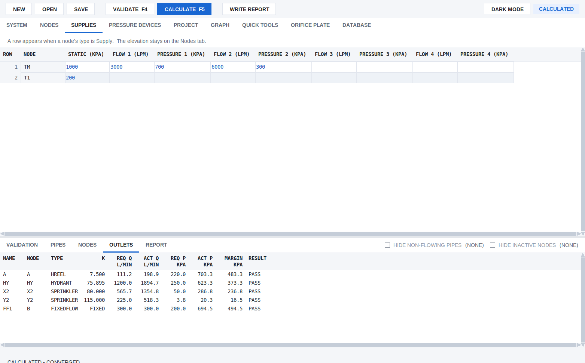

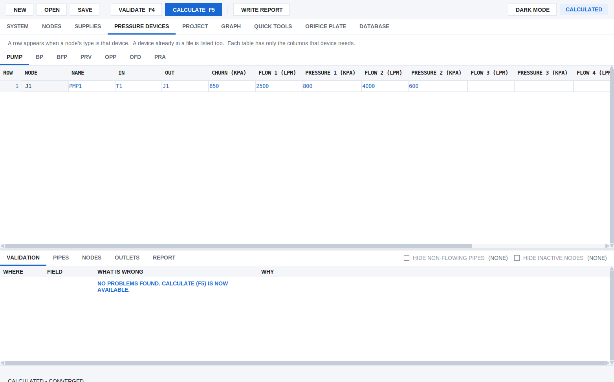

Lines the grids do not edit (design areas, supply graphs, check valves,
dry pipe valves, scenarios) are kept in the file exactly as written.  Edit
them in the text editor.

## 10. The isometric drawing

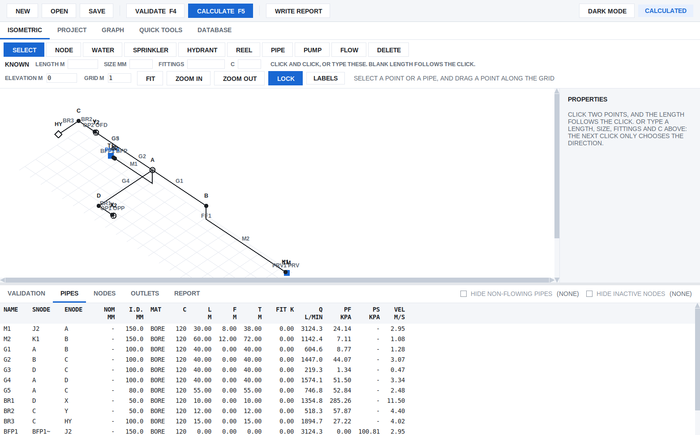

`phcp_isometric` draws the same model on a 30-degree grid, with elevation
on the vertical axis.  The results tabs are the editor's.

- **Placing.**  Choose a tool (NODE, WATER, SPRINKLER, HYDRANT, REEL, PIPE,
  PUMP, FLOW) and click the grid.
- **Drawing a pipe.**  Click one point, then the next: the length is the
  distance between them.  Or type the LENGTH, SIZE, FITTINGS and C under
  KNOWN first; the next click then only chooses the direction.  Clicking a
  point that already exists joins it.
- **SELECT** drags a point along the grid.  The selected pipe or point has
  its properties on the right; Return writes a field.
- **LOCK** (on by default) keeps every pipe along the grid axes.  **FIT**
  scales the whole network into view.  **LABELS** chooses what is written
  on the drawing.

Where each point sits is saved as `//ISO` comment lines, which the
calculation ignores.  A model without them is laid out from its pipes and
elevations when it is opened, as in the picture.

## 11. Water supply graph

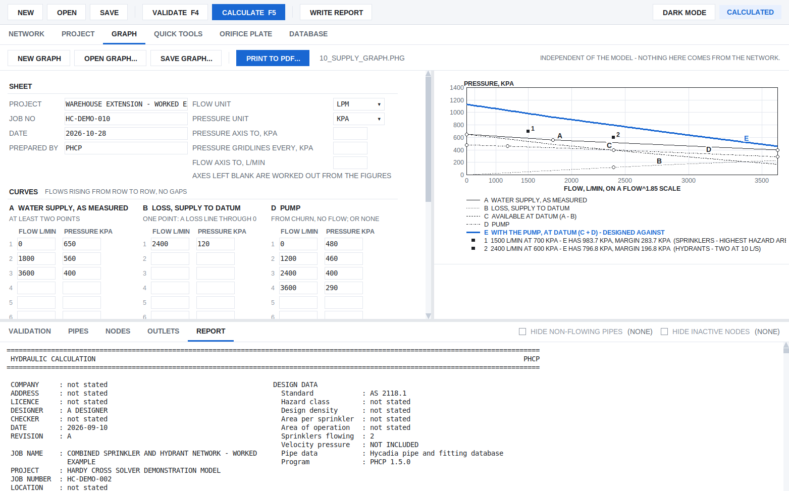

The GRAPH tab draws a water supply graph on Q^1.85 paper from figures typed
in, such as a flow test and a pump data sheet.  It does not use the model.
The curves are:

| Curve | What it is |
|---|---|
| A | the water supply as measured (at least two points) |
| B | the loss from the supply to the datum: pipework, meter, backflow device, height |
| C | the supply available at the datum, A - B |
| D | a pump curve from churn, or none |
| E | the supply with the pump, C + D |

Up to ten DUTY points are each compared with the curve designed against (E
with a pump, C without), with the margin or shortfall.  A problem is listed
under the graph, and a click goes to its field.  PRINT TO PDF writes an A4
sheet.  SAVE GRAPH and OPEN GRAPH keep the figures in a `.phg` file.
`SUPPLYGRAPH town.phg` in a model adds the graph to that model's report.
The picture is `examples/10_supply_graph.phg`.

## 12. Quick tools and the orifice plate

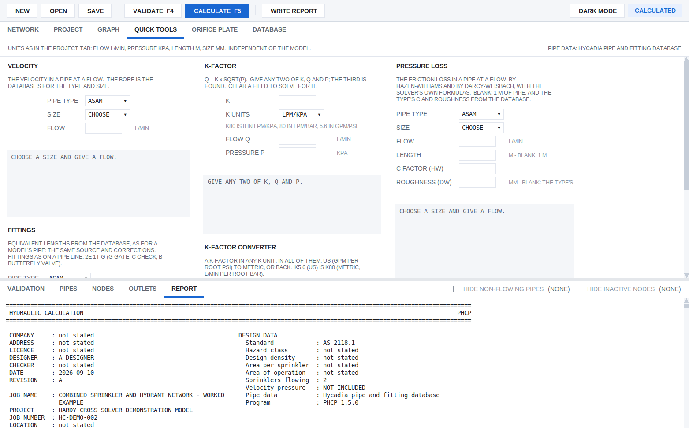

QUICK TOOLS has five calculators that answer as you type, in the PROJECT
tab's units, independent of the model:

- **VELOCITY** in a pipe at a flow;
- **FITTINGS**: the equivalent length of a fitting string;
- **K-FACTOR**: give any two of K, Q and P to get the third;
- **K-FACTOR CONVERTER** between unit systems;
- **PRESSURE LOSS** in a pipe at a flow, by Hazen-Williams and
  Darcy-Weisbach.

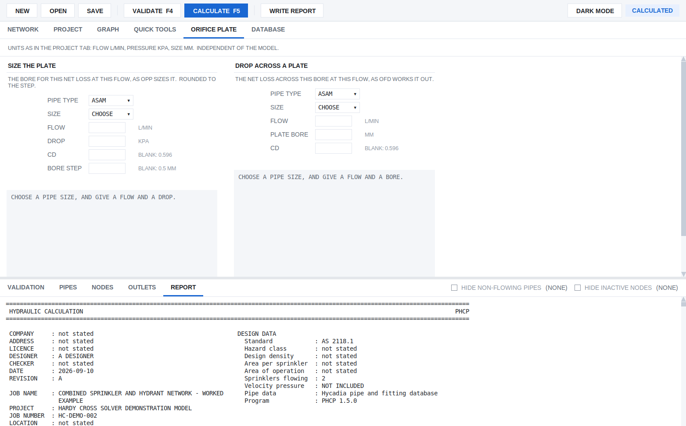

ORIFICE PLATE gives either the bore that produces a given net loss at a
flow, or the net loss across a given bore.  It uses the same calculation as
the model's `OPP` and `OFD` lines.

## 13. The pipe and fitting database

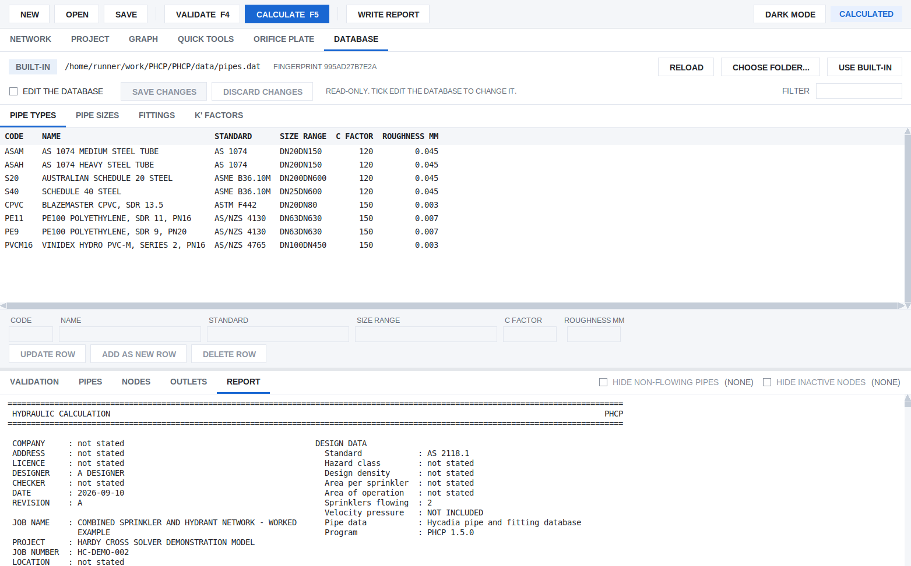

The DATABASE tab shows the pipe types (bores by nominal size, C factor,
roughness) and the fitting equivalent lengths that every calculation uses.
Filter to find an entry.  Tick EDIT THE DATABASE to change one.  A team can
share one database by choosing a team folder here.  The report states which
database a calculation used.

## 14. Supplies, pumps and check valves

- **Several supplies.**  With more than one `WATER` line, the report gives
  each supply's operating point and its share of the flow, and PHCP finds
  the joint demand.
- **Pumps** follow their curve.  A pump with a check valve that would run
  backwards is shut, and the network is solved again.
- **A check valve at a supply** is not assumed.  Give one with
  `NRV <SUPPLY> <CV> [CRACK]` (and `NRVMODEL` for its make and model).  A
  supply with a check valve that would take water in shuts and gives
  nothing.  If every supply that can reach part of the network has shut,
  that part has **lost its supply**: the result is NONCOMPLIANT and the
  outlets cut off are named.  Without an `NRV` line, a supply that takes
  water in makes the result REJECTED.  Section 10 of the report has a SUPPLY
  CHECK VALVES table: each valve's state, flow, pressure and loss.
- **Dry pipe valves** (`DPV`) take their loss from the database or the
  model.  `DPVAIR` and `DPVTRIP` give ESTIMATED trip and transit times.

## 15. Without a window: the command line and JSON

```
phcp.exe model.phc report.pdf          the report as PDF
phcp.exe model.phc report.txt          ...or as text
phcp.exe --json model.phc              the results as JSON, for another program
phcp.exe --strict model.phc            exit 0 for ACCEPTED only
phcp.exe model.phc --save              save the results back into the model, as a comment block at its end
phcp.exe model.phc --annotate out.phc  with auto sizing: the chosen sizes written into a copy
```

The exit code says the result:

| Exit | Result |
|---|---|
| 0 | ACCEPTED, or NONCOMPLIANT without `--strict` |
| 1 | INDETERMINATE: the results must not be used |
| 2 | the model could not be read, or its network is broken; nothing was solved |
| 3 | REJECTED: the results must not be used |
| 4 | NONCOMPLIANT, with `--strict` |

A script that treats 0 as approved must use `--strict`, or read `approved`
in the JSON.  The README section "Calling PHCP from another program" has the
JSON layout.

## 16. When something goes wrong

| You see | Likely cause |
|---|---|
| CALCULATE is greyed out | the model has changed since it last passed VALIDATE; press F4 |
| a red line in the editor | the reader refuses it; the status bar and the VALIDATION tab say why |
| a node in the NODES list | defined but connected to nothing, or named by a pipe and never defined |
| REJECTED: a supply taking water in | a weaker supply is being back-fed.  Add a check valve (`NRV`) if one is installed |
| NONCOMPLIANT: LOSS OF SUPPLY | every check valve that could feed part of the system is shut; the outlets named get no water |
| INDETERMINATE | the solve did not settle.  Look for a device switching back and forth (a pump or check valve on the edge of opening), a pipe of zero length, or extreme sizes |
| a curve marked extrapolated | a supply, pump or loss curve used beyond its last point; give a point further out |
| the calculation is slow | large grids take time with Hardy Cross; every loop correction is traceable in the report.  The status bar shows progress |

If a model behaves in a way you cannot explain, report it with the `.phc`
file.  A model that is refused when it should not be, or accepted when it
should not be, is a defect.
